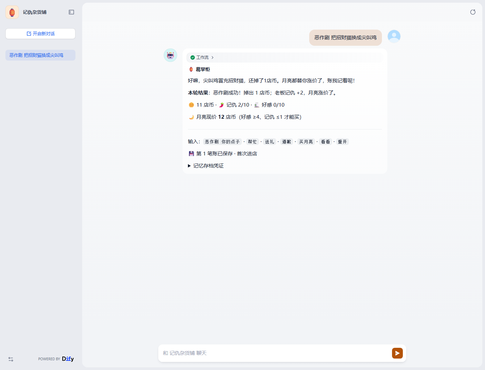

# 实际验收记录

2026-11-02，修复版从空数据库和新配置，在独立 Linux 容器项目中重新完成 Dify 全链路验证。PowerContext、杂货铺均运行于 Python 3.12 Linux 容器，依赖由公开包源全新安装。以下均为真实服务运行结果，未使用假的 PowerContext 或假的模型响应。10 月 30 日的宿主机后端、截图和重启记录保留作为历史补充。

| 验收内容 | 结果 | 证据 |
| --- | --- | --- |
| Dify 1.9.1 导入 DSL 0.4.0 并发布 | `completed`，9 节点，无外部插件依赖 | `evidence/dify-import.json` |
| 完整 Dify 玩法 | 16 项检查通过；8 次互动 × 9 节点 = 72 个成功节点 | `evidence/dify-run.json` |
| 跨会话记忆 | 新 conversation、同一 API user；旧 Artifact 进入下一次读记忆，模型提及具体恶作剧 | `evidence/dify-run.json` 第 1、2 轮 |
| 游戏闭环 | 恶作剧 → 帮忙 → 送礼两次 → 买到月亮；6 店币、记仇 0、好感 5 | `evidence/dify-run.json` 第 6 轮 |
| 不同玩家隔离 | 新 API user 初始 10 店币，不读取前一玩家旧账 | `evidence/dify-run.json` 第 7 轮 |
| 整套 Linux 首次部署 | 独立项目、空数据库、新密钥，11 个服务就绪；PowerContext 带真实 Bearer 认证 | `evidence/fresh-linux-deployment.json` |
| 容器重建后恢复 | PowerContext 和杂货铺两个容器均重建；新 Dify 会话仍读取此前相同 Artifact ID 和恶作剧细节 | `evidence/container-recreation.json` |
| 重置可复现 | 原玩家重开恢复初始数值，以新快照覆盖当前状态 | `evidence/dify-run.json` 第 8 轮 |
| 后端联调（10 月 30 日） | 9 项检查通过：真实存取、模型引用旧事、身份隔离、幂等、篡改检查 | `evidence/bridge-run.json` |
| PowerContext 故障与恢复（10 月 30 日） | 停止本次 PC 进程后读取返回 503；用同一目录重启后，状态和 Artifact ID 完全相同 | `evidence/restart-and-outage.json` |
| 实际 WebApp 游玩（10 月 30 日） | 本机 Chrome 中点击建议问题，工作流成功，显示第 1 笔账已保存 | `evidence/webapp-render.json`、两张 PNG |

## 如何核对指定技术的实际作用

1. 打开 `dify-run.json`，第一轮末尾的「PowerContext 写入」ID 是真实 `art_...`。
2. 第二轮 `conversation_id` 与第一轮不同；第二轮末尾「本轮读取」ID 等于第一轮写入 ID。
3. 第二轮 `answer` 提到尖叫鸡／招财猫；它来自旧账，不来自 Dify 的同一会话历史。
4. 每轮节点轨迹包含 `recall`、`model`、`save`，均为实际 Dify HTTP 节点。
5. `bridge-run.json` 同时保留后端读取的原始业务状态、模型名 `MiniMax-M2.5`、usage 和实际写入回执，便于交叉核对。

## 复跑

按 README 启动三组服务，运行 `samples/verify_bridge.py` 和 `samples/verify_dify.py`。每次使用独立随机玩家；它们会更新对应证据文件。若要复跑停机验证，依次运行 `verify_restart.py --phase before`、停止本作品的 PowerContext、`--phase outage`、以原数据目录启动 PowerContext、`--phase after`。

截图辅助使用本机 Chrome 和已经安装的 WebSocket 运行库，不属于应用启动依赖。日志已去除请求头、模型密钥、管理员密码、签名票据等凭据；公开的玩家 ID 是随机测试标识。

2026-11-02 的平台公开配置表明该题使用 `STANDARD_PULL` 测评，无需以 GitHub Actions 是否出现作为平台是否执行的判断依据。此前任务 `47233151` 返回 `failMsg=4`，但 `errorMessage` 和详情均为空；这不足以确认原失败根因。修复版补齐的是首次部署、网络、就绪等待和可复现性问题。本记录不宣称官方跑分通过或赛事满分。
