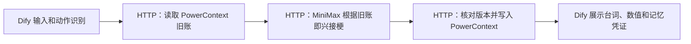

# 记仇杂货铺 🏮

**你可以捉弄 AI 老板，但别指望开个新会话就能赖账。**

葛掌柜经营一家卖离谱商品的小店。把招财猫换成尖叫鸡，会赚到一枚掉落的店币，也会惹老板记仇、让镇店之宝涨价。再开一个 Dify 会话回来，老板依旧记得具体的恶作剧。帮忙、送礼、道歉，最后买走「会打嗝的月亮」，达成「冤家熟客」结局。

本作品按 `oceanbase/powercontext` 的 **`2026-competition-ecosystem`** 分支开发，全部资产位于 `dify/`。不用 `vldb_2026` 作为本题基线。

## 技术分工



- **Dify 必选核心**：Chatflow 负责输入处理、动作识别、HTTP 调用顺序、每步状态检查和最终回答。不是把整个应用包进一个 HTTP 节点；读取、模型调用、保存是三个独立且有依赖关系的节点。
- **PowerContext 1.4.1**：为每个玩家建立 Scope；所有店币、记仇、好感、结局、近期互动和长期恶作剧记忆都保存在真实 Atomic Memory 中。每轮读取旧记忆，提供给模型，再写新快照。Dify 会话历史不承担跨会话存档。
- **MiniMax**：通过后端调用实际模型，生成有性格的中文台词。密钥只在后端。LLM 不能修改游戏数值或伪造存档。
- **Python 后端**：执行固定游戏规则，验证签名、版本和重复提交；本地 SQLite **只保存匿名玩家到 Scope 的映射，不保存游戏状态**。
- 本作品选择 **Dify + PowerContext**，不要求 seekdb，不使用知识库、Embedding、Rerank 或自定义插件。Dify 自带 PostgreSQL 只用于 Dify 自身元数据。

## 交付文件

| 路径 | 用途 |
| --- | --- |
| `dsl/grudge-shop.yml` | 唯一 DSL，直接导入，无其他 DSL 导入顺序依赖 |
| `app/` | 杂货铺 HTTP 后端、确定性游戏规则 |
| `scripts/deploy_dify.py` | 获取固定版本官方源码并部署独立本机 Dify |
| `scripts/import_dify.py` | 初始化本作品的独立 Dify、绑定本地凭据、导入并发布 |
| `scripts/run_service.py` | 启动 PowerContext 或杂货铺，支持读取已有模型配置 |
| `samples/verify_bridge.py` | 后端真实服务验证 |
| `samples/verify_dify.py` | 经已发布 Dify API 执行完整玩法和跨会话验证 |
| `samples/SCENARIO.md` | 评审可手动执行的样例 |
| `evidence/` | 实际运行记录；不包含密钥、签名票据或管理员密码 |
| `ACCEPTANCE.md` | 验收结论和证据索引 |

## 环境与资源

- 已验证环境：Windows 11、Docker Desktop Linux containers、Python 3.13。
- 建议 Python 3.11～3.13，Docker Compose 2.24+，Docker 分配至少 4 CPU / 8 GB RAM；首次需下载数 GB 镜像，磁盘预留约 15 GB。
- **Dify 1.9.1**，官方源码 commit `cd47a47c3b4acc4d4457b73777722602c33bc950`；DSL 格式 `0.4.0`。固定旧版本用于比赛复现，未声明其他版本兼容。
- **PowerContext 1.4.1**，其余精确版本见 `requirements.txt`。当前工作区复用已安装的同版本依赖，未引入另一个框架。
- 模型为 MiniMax 的兼容 Chat Completions HTTP 服务；本地实际模型名见 `evidence/bridge-run.json`。评审需准备自己的有效模型凭据，模型服务可能计费。
- 不需要安装第三方 Dify 插件。部署包含官方 plugin daemon 作为 Dify 基础组件，但本 DSL 无插件依赖。

## 从零启动

以下命令从仓库根目录进入 `dify/`，后续保持该工作目录。Windows PowerShell：

```powershell
Set-Location dify
uv venv .venv --python 3.13
uv pip install --python .venv/Scripts/python.exe -r requirements.txt
.\.venv\Scripts\python.exe scripts/init_env.py
```

Linux/WSL 对应解释器是 `.venv/bin/python`。PowerContext 在 Windows 上属于 experimental 平台；遇到平台问题可按相同流程使用 WSL/Linux。

### 1. 配置模型

在生成的 `.env` 中补充下列值，或在启动时使用 `--model-env` 读取自己的现有文件：

```dotenv
MINIMAX_CHAT_URL=https://api.minimaxi.com/v1/text/chatcompletion_v2
MINIMAX_API_KEY=YOUR_MODEL_API_KEY
MINIMAX_MODEL=YOUR_ENABLED_MODEL_NAME
```

`MINIMAX_CHAT_URL` 是**完整 Chat Completions URL**。后端使用兼容的 `messages`、`model`、`choices[0].message.content` 协议。该环境变量名称沿用团队已有配置，不能保证任意模型提供商都兼容。不要提交真实 `.env`。

### 2. 部署 Dify

启动 Docker Desktop，执行：

```powershell
.\.venv\Scripts\python.exe scripts/deploy_dify.py
```

脚本获取固定版本的 Dify 官方部署目录，保存在 `.runtime/`，创建独立 Compose 项目 `grudge-dify`，并为 PostgreSQL、Redis 和存储创建独立具名卷。只向本机暴露 `http://localhost:18080`。未使用的向量数据库不启动。

镜像下载或 checkout 因网络失败时，重试同一命令。已有容器和卷会复用。脚本不停止其他项目容器。

### 3. 启动 PowerContext（终端 1）

```powershell
.\.venv\Scripts\python.exe scripts/run_service.py memory
```

监听 `127.0.0.1:8011`，持久数据位于 `.runtime/powercontext/`。本题用显式 Memory API，不需要为 PowerContext 配生成模型或 Embedding；启动时对应能力提示属于预期。

### 4. 启动杂货铺（终端 2）

```powershell
.\.venv\Scripts\python.exe scripts/run_service.py shop
# 可选：只在本地读取另一份模型配置，不复制其中的密钥
# .\.venv\Scripts\python.exe scripts/run_service.py shop --model-env D:\your-private-model.env
```

后端监听 `0.0.0.0:8012`，以便 Dify 容器通过 `host.docker.internal:8012` 访问。所有游戏接口需要独立 `SHOP_API_KEY`；请在受控本地网络运行。仅启动一个 worker。`/health` 不返回密钥。

### 5. 导入并发布（终端 3）

等待 Dify 容器就绪，然后执行：

```powershell
.\.venv\Scripts\python.exe scripts/import_dify.py
```

脚本只初始化本次部署的空白 Dify，生成本地管理员账号，把 DSL 的占位凭据替换为当前后端密钥，导入并发布 Chatflow。控制台输出可直接体验的 `/chat/...` 地址；管理员登录和应用 API Key 保存于 **`.runtime/dify-access.json`**，不会打印或提交。已有不属于本作品的实例且没有本地登录文件时，脚本拒绝初始化。

**手工导入也可**：打开 `http://localhost:18080` → 创建应用 → 导入 DSL → 选择 `dsl/grudge-shop.yml` → 设置工作流环境变量：

| 变量 | 配置 |
| --- | --- |
| `SHOP_BASE_URL` | 容器内可访问的后端，例如 `http://host.docker.internal:8012`，末尾不带 `/` |
| `SHOP_API_KEY` | 与后端 `.env` 中的值相同，类型保持 Secret |

无需绑定知识库或模型插件；模型配置在配套后端。保存并发布，打开 Dify 自带 WebApp 即可游玩。

## 网络条件

1. 浏览器 → Dify：本机 `18080`。
2. Dify HTTP Request → 杂货铺：`host.docker.internal:8012`。部署脚本仅为这个主机添加 Squid 允许项，未关闭整个代理。
3. 杂货铺 → PowerContext：本机 `8011`。
4. 杂货铺 → MiniMax：HTTPS 出网；默认不读取系统代理，网络须能直接访问配置的模型 URL。
5. 初次部署须能访问 GitHub、Docker Hub、Python 包源。

Linux Docker 若不能解析 `host.docker.internal`，在 `.runtime/dify/docker-compose.yaml` 的 `ssrf_proxy` 服务增加 `extra_hosts: ["host.docker.internal:host-gateway"]`，确保宿主机防火墙允许容器访问 `8012`，再重建代理容器。

## 玩法与完整验证

操作使用独立命令或「命令 + 空格 + 点子」：

| 输入 | 规则 |
| --- | --- |
| `恶作剧 把招财猫换成尖叫鸡` | 店币 +1，记仇 +2；记下具体点子 |
| `帮忙` | 店币 +2，好感 +1 |
| `送礼` | 花 2 店币，好感 +2，记仇 -1 |
| `道歉` | 记仇 -2 |
| `买月亮` | 好感 ≥4 且记仇 ≤1，支付当前价后达成结局 |
| `看看` 或其他聊天 | 根据账本回应，不改变币数和关系 |
| `重开` | 写入新的初始快照；历史记忆保留审计，旧状态不再生效 |

月亮价格 `max(3, 8 + 2 × 记仇 - 好感)`。记仇和好感范围 0～10，店币最多 99。完整手动样例见 [SCENARIO.md](samples/SCENARIO.md)。

```powershell
.\.venv\Scripts\python.exe samples/verify_bridge.py
.\.venv\Scripts\python.exe samples/verify_dify.py
```

脚本为每次运行生成全新测试玩家，不依赖作者既有数据。Dify 验证的每一轮都创建新 conversation、保持同一 API `user`，从而排除 Dify 会话历史产生的假记忆。新浏览器或清理浏览器存储会获得新匿名身份；API 必须保持 `user` 不变才能召回原账本。

## 存储、故障与边界

- 初始化不需要数据集；首次游戏自动创建玩家 Scope 和空账本。保留 `.runtime/powercontext/` 与 `.runtime/shop/` 才能恢复同一存档。
- PowerContext 读失败直接报错，不把故障当作空账本；模型失败不写入状态；写失败不显示「已保存」。Dify 在对应检查节点终止并显示失败，可修复依赖后重试。
- 提交票据有效期 5 分钟，模型台词带签名，写入前重新核对账本序号。同玩家并发回合只允许一个版本提交，冲突返回 409。
- 最近 **3 个操作 ID** 可重复提交而不重复计分；这是有限的重试窗口，不是无限幂等保证。极长时间后的写入超时属于结果不确定，应先「看看」确认账本。
- 快照保存最近 5 次互动与最近一次恶作剧；恶作剧细节最多 100 字，AI 台词最多 240 字。长期恶作剧字段不随普通聊天滚出窗口。
- 单进程演示后端采用内存锁，不支持多实例同时写同一玩家。历史快照逐条保留，读取会遍历分页；大规模使用需增加生命周期管理。
- AI 即兴台词没有唯一答案，数值和存档凭证才是确定的规则结果。模型可能偶尔接梗不佳或省略细节；验证脚本会明确报告未满足的叙述断言，不伪造证据。
- 停止：在两个 Python 终端按 Ctrl+C；Dify 在 `.runtime/dify/` 执行 `docker compose -p grudge-dify down`。不加 `-v` 可保留数据。

## 来源

玩法、规则、后端与 DSL 为本作品原创，未复用公开娱乐工作流、角色或数据集。项目代码按 Apache-2.0 交付；依赖各自遵守原许可。

- [比赛基线](https://github.com/oceanbase/powercontext/tree/2026-competition-ecosystem)
- [PowerContext 文档](https://powercontext.oceanbase.io/en/docs/)
- [Dify 1.9.1 官方源码和许可证](https://github.com/langgenius/dify/tree/1.9.1)
- [Dify HTTP Request 节点](https://docs.dify.ai/en/use-dify/nodes/http-request)
- [Dify 官方 Docker Compose 部署说明](https://docs.dify.ai/en/self-host/quick-start/docker-compose)

未修改比赛官方测试文件。比赛提交 commit、PR 和平台字段见 [SUBMISSION.md](SUBMISSION.md)。
